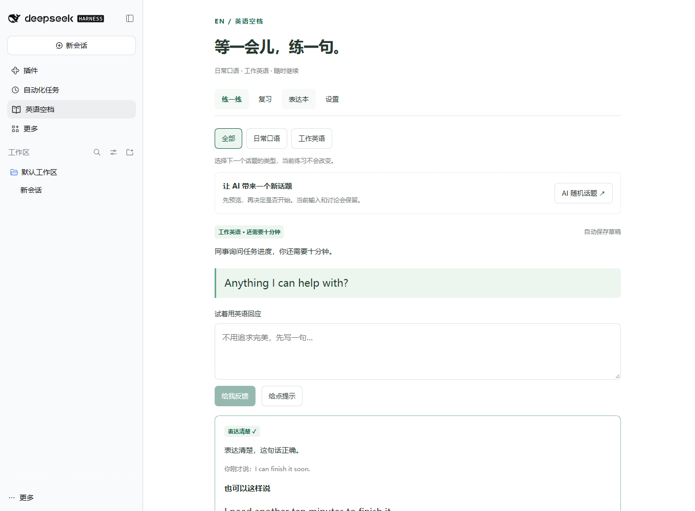

# dsh-english-break · 英语空档

An open-source English practice plugin for DeepSeek Harness. Practice everyday conversations and workplace English during short breaks.

## 功能

- 日常口语、工作英语及 AI 随机话题预览。
- 造句反馈、连续对话和对纠错结果继续追问。
- 表达收藏、间隔复习、草稿保存与数据导入导出。
- 默认跟随 DSH 系统模型，可手动选择；支持取消与生成进度。
- 原生主面板与右侧面板，适配小窗口滚动。

## 安装方式（按 DSH 官方 Bundle 规范）

这是非官方社区插件，由 qiufengsir 独立维护。兼容 DSH **0.2.1-rc.3**，其他版本尚未验证。

### 预构建安装包（推荐）

从 [Releases](https://github.com/qiufengsir/dsh-english-break/releases) 下载最新的预构建 `.tgz`，使用 DSH 插件安装入口选择文件，或完全退出桌面版后运行：

```sh
dsh plugin --profile desktop add ./dsh-english-break-0.3.0-alpha.2.tgz
```

预构建包不需要授权源码构建脚本。

### GitHub 源码安装

```sh
dsh plugin --profile desktop add github:qiufengsir/dsh-english-break#v0.3.0-alpha.2
```

包内 `prepare` 会从源码构建。pnpm 10+ 第一次可能拒绝执行构建；按终端提示，将它打印的**确切包键**加入该 profile 的 `pnpm-workspace.yaml`，再重试。常见形式：

```yaml
allowBuilds:
  dsh-english-break: true
```

这项授权允许运行本项目构建代码。只为可信源码授权，建议将版本标签替换为本次发布的固定提交 SHA。无需修改 DSH 安装目录，`dsh.bundle.patch` 会注册插件。

### 在「插件 → 发现」添加市场索引

在 DSH 启用「实验性插件 → 自定义插件市场」，进入「插件 → 发现 → 添加索引源」，填写：

```text
https://qiufengsir.github.io/dsh-english-break/index.json
```

这是本项目自己维护的市场源，不是官方审核或默认收录。索引使用 `format: 1`，固定 Git 提交、版本和兼容范围。Git 来源的安装仍需上述构建授权。Pages 暂不可访问时可备用：`https://raw.githubusercontent.com/qiufengsir/dsh-english-break/main/docs/index.json`。

### 界面示意

下图来自原生 DSH Web Host 集成测试，使用固定模型响应，不是学习效果或真实模型质量证明。



发布规范：[打包与安装插件](https://deepseek-harness.github.io/deepseek-harness/develop/basic/publish)。

## 源码开发

当前兼容 **DeepSeek Harness 0.2.1-rc.3**，开发环境需要 Node.js 24 或更新版本。

```sh
git clone https://github.com/qiufengsir/dsh-english-break.git
cd dsh-english-break
npm install
npm run typecheck
npm test
npm pack
```

在 DSH 的插件安装入口选择生成的 `dsh-english-break-*.tgz` 文件。首次启用后可在侧栏打开「英语空档」。默认使用 DSH 全局默认模型；也可在插件设置中手动选择。

本地开发可运行 `node scripts/desktop-local.mjs install`；空闲时重启 DSH。移除用 `node scripts/desktop-local.mjs remove`。脚本只修改本插件的用户补丁并备份原配置。打包安装和本地补丁不要同时启用。

## 数据与模型调用

模型调用会将英语练习内容发给 DSH 所配置的模型服务，可能产生相应用量。插件不读取工作对话、源码或剪贴板。学习数据保存在 DSH home 的 `storages/dsh-english-break`，可在设置导出备份。

## 验证范围

核心自动化测试覆盖数据持久化、长对话、模型输出解析和复习。开发期间另在独立 DSH 0.2.1-rc.3 Web Host 验证过原生客户端、认证接口、收藏后连续对话、取消、分段响应、随机话题预览和系统模型读取。真实模型反馈质量及 Electron 完整交互不等同于这些测试已通过。当前仅支持文字表达，不提供发音评分。

## License

MIT. See [LICENSE](LICENSE).

---

## 使用细节

默认「跟随 DSH 系统默认模型」，每次请求读取 DSH 的 `agentDefaultModel.currentSelection()`，包括默认模型的思考档位。系统默认变更在下一次练习生效；不改变工作会话，也不跟随单个会话的临时模型。设置里仍可手动选择插件专用模型。旧版本未记录选择方式的学习数据默认按系统跟随模式处理；已明确选择手动的记录继续保留。

模型调用输出预算提高到 16384 tokens，服务端最多等待 180 秒；前端进度查询留有额外 15 秒余量。预算是上限，不要求模型写满，反馈仍要求简短实用。追问正文最多保存 32000 字符；结构化反馈继续做字段校验。服务自行结束、超时和输出截断会明确提示，原输入保留。默认模型读取、无需手选的场景生成及手动模型路径已通过独立 DSH Host 的固定响应测试，真实服务速度和用量未在测试中测量。

对话不再在第 3 次回应后强制结束；输入框保持可用，由用户点击「结束本轮」。收藏句子保留当前对话，可继续输入和获得反馈。完整练习历史保存在本地，模型反馈只携带最近 6 次回应，避免长对话不断扩大单次请求。已验证第 3 至第 5 次回应收藏后继续输入与发送，以及 12 次回应保存后恢复。

练习页「全部 / 日常口语 / 工作英语」决定下一个话题类型，不会切换当前练习。「AI 随机话题」由所选模型即时生成新情境与开场白，不是联网检索新闻或只抽取内置题目；生成前需选择模型。

换题采用两步：先生成预览，再点击「开始这个话题」。生成、取消、失败或选择「暂不切换」都保留当前输入与讨论。确认开始后可「返回上一话题」恢复上一个练习，保留最近一对话题来回切换，非无限历史。预览与上一话题也随学习记录持久化。改变下个话题的分类会清除尚未接受的预览，不影响当前练习。

模型返回的标题、情境和开场白是核心必填内容，提示词、句首、参考句和追问可缺省；缺省时不伪造参考答案。解析支持提示词数组、常见外层对象与 JSON 代码块，核心内容不完整时在换题区域提示重试，不要求刷新学习进度。

每条最新造句反馈下有「追问这条反馈」，支持用中文质疑、询问原因或索要例子，并可连续追问。讨论与该条反馈一起保存，不占造句轮次，也不覆盖正在填写的英语回应。每条反馈最多追问 20 次；重新表达会替换该次反馈及讨论。讨论同样调用所选模型并产生服务用量。

追问使用后台任务与短请求查询进度，点击后立即显示「正在回答」。模型思考时显示状态，正文逐步返回；取消、超时或失败在追问区域显示，并保留输入。尚未完成的部分回答不会写成已完成的讨论。原生客户端测试覆盖慢响应、逐步返回、取消和取消后重新发送；真实服务的错误与速度取决于所选模型。

左侧「英语空档」打开完整面板，也可在会话右侧选择「英语空档」。先在设置里选择 DSH 已配置的模型，再点击「练两分钟」。包含 6 个日常、6 个工作场景、渐进提示、造句反馈、再次表达、收藏与到期复习。没有模型时可使用参考句练习。

提交反馈、追问或生成随机话题会调用模型，可能产生所选服务的用量费用。插件不读取工作对话、代码或剪贴板，不将练习写入工作会话。不提供语音识别或发音评分。

学习记录默认位于 DSH home 下 `storages/dsh-english-break/state.json`。草稿切换面板后保留，输入约 400ms 后保存；保存完成后重启可恢复。设置支持 JSON 导入导出，导入替换当前进度。收藏不代表掌握，首次收藏次日复习。

